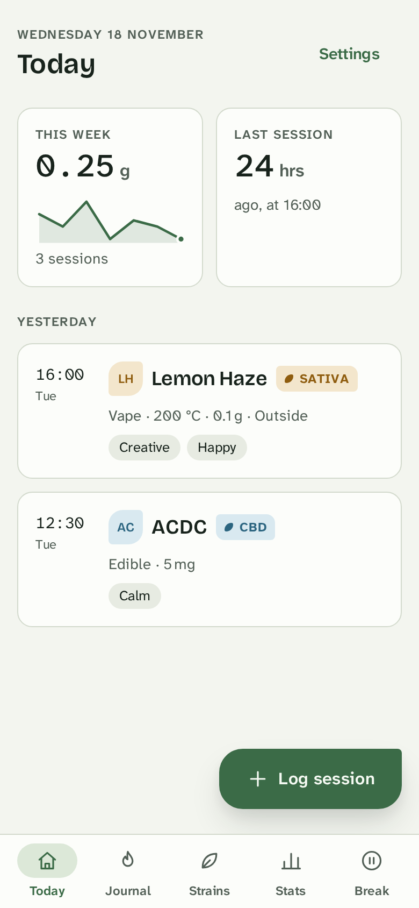
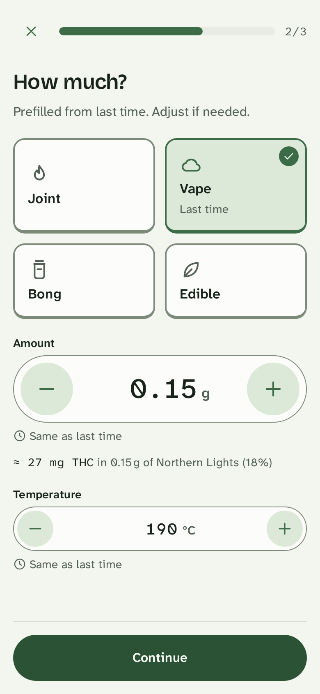
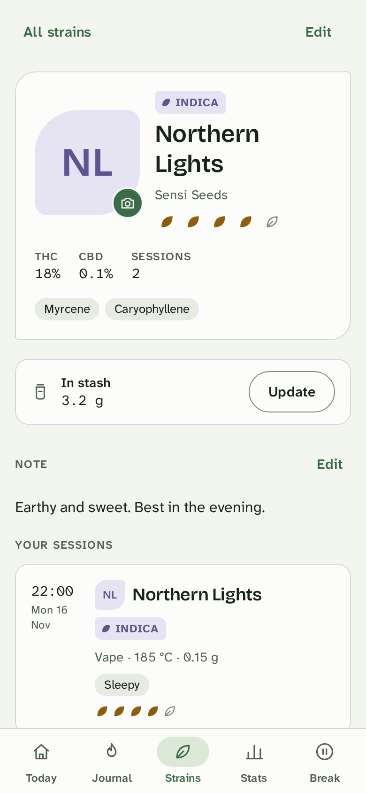
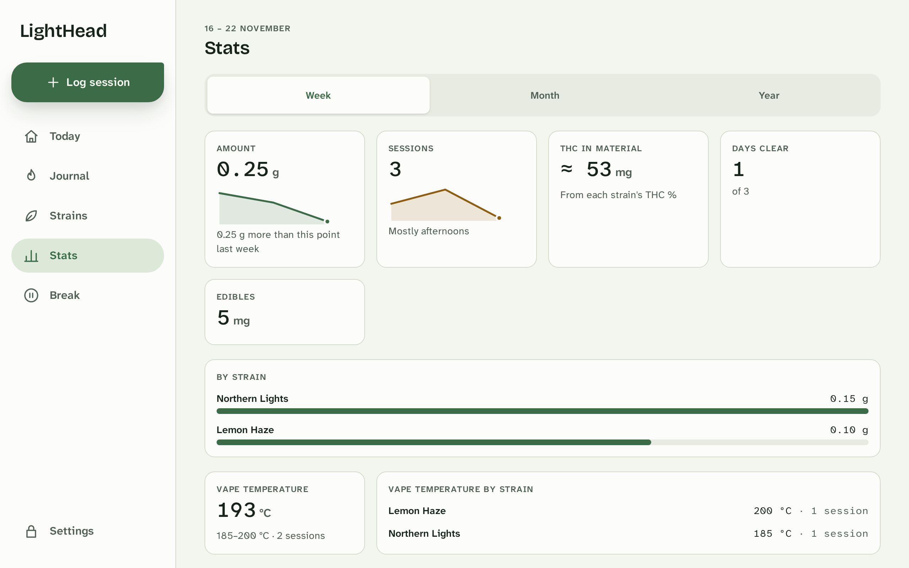

# LightHead

A quiet, private journal for cannabis use. Log sessions in three taps, keep a library of your strains, plan tolerance breaks and see simple statistics. Everything stays on your device: no account, no tracking, nothing sent anywhere.

**Open the app: [use.lighthead.app](https://use.lighthead.app)** · free and open source (AGPL-3.0)

<p>



</p>


## Why

Most cannabis apps are shops, social feeds or ad platforms, and they keep your data on their servers. LightHead is a notebook: it records what you had and how it felt, and helps you notice your own patterns. It never judges. There are no warnings, streaks or praise, and nothing about your use leaves your device.

## What it does

- **Quick log.** Three questions, one per screen: which strain, how much, how it felt. Everything is prefilled from last time, so the fastest log is Continue, Continue, Skip.
- **Strains.** Name, type, THC and CBD from the label, terpenes, a photo, your rating and your own note. Logging works out the THC in what you used (grams × THC % × 10, shown as "≈ 27 mg THC").
- **Stash.** Logging flower takes it off the strain's stash; update it when you buy more.
- **Vaporiser temperature.** Vape sessions remember the temperature, per strain, in °C or °F.
- **Journal.** Every session by day; tap one to edit or delete it.
- **Stats.** Week, month or year: amount, sessions, THC in material, days clear, use by strain and your usual vape temperature. The amount is compared with the same point of the previous period.
- **Tolerance breaks.** Plan a break of 2, 7, 14, 21 or 28 days, follow the days, keep notes. Logging during a break asks first, without judging.
- **Your data, your copy.** Save the whole journal to a file and restore it on another device.
- **Works offline, installs like an app**, in English, German and Polish, light and dark, on phones and computers.

## Privacy

- Your journal lives in your browser's storage on this device. There are no accounts and no database on a server.
- LightHead sends nothing anywhere: no analytics, no ads, no crash reports, no fonts or scripts from other sites. The browser enforces this through the app's Content-Security-Policy (`static/_headers`), and an automated test (`e2e/offline.e2e.ts`) checks that the app makes no requests to other sites.
- Cloudflare serves the app's files. Like any web host it can see that someone downloaded them (IP address and time), but never what you log.
- After the first visit the whole app is stored on the device and works offline.
- Each browser keeps its own separate journal, and clearing the browser's data for this site deletes it. Save a backup file in Settings now and then.
- A backup file is plain, unencrypted JSON with your whole journal, photos included: keep it somewhere private.
- The app has no lock of its own: anyone who can use your unlocked device can open it.
- Strain photos are cropped and redrawn before saving, which removes hidden metadata such as GPS location.

The app explains the same in Settings → How your data is kept. To report a security problem, see [SECURITY.md](SECURITY.md).

## Install it

Open [use.lighthead.app](https://use.lighthead.app). On first launch, onboarding shows how to add it to your home screen:

- **iPhone and iPad (Safari):** Share → Add to Home Screen.
- **Android, Chrome and Edge:** the Install button in onboarding, or Install app in the browser menu.
- **Safari on Mac:** File → Add to Dock.

Installed, it opens in its own window, works without internet, and the browser is much less likely to clear its storage.

Questions are answered in the app under Settings → Questions.

## Roadmap and contributing

Plans and known issues are [GitHub issues](https://github.com/dev-oskar/lighthead/issues). Ideas and bug reports are welcome there. A contributor guide is on its way ([#6](https://github.com/dev-oskar/lighthead/issues/6)); until then, open an issue before starting larger work.

## For developers

Needs Node 22+.

```sh
npm install
npm run dev        # http://localhost:5173
npm run build      # static site in build/
npm run preview    # serve the build (with the service worker) on :4173
```

### Checks

```sh
npm run check                     # svelte-check (types)
npx vitest run                    # unit tests (src/lib/model.spec.ts)
npx playwright install chromium   # once
npx playwright test --workers=1   # end-to-end; builds and serves the app itself
```

The end-to-end suite includes an offline test that fails if the app contacts any other origin, and checks it keeps working with the server unreachable.

### Stack

- Svelte 5 (runes) + SvelteKit 3 with `adapter-static`: a client-only SPA (`ssr = false`), no virtual DOM
- IndexedDB through [`idb`](https://github.com/jakearchibald/idb)
- SvelteKit's service worker (`src/service-worker.ts`) precaches the whole app; a new version waits for the in-app Reload notice
- No UI framework or chart library: components are a Svelte port of the LightHead design system, charts are inline SVG
- Fonts are self-hosted; there are no runtime dependencies on other sites

### Project layout

| Path | What |
| --- | --- |
| `src/routes/` | Screens: Today (`+page.svelte`), Journal (`log`), quick log (`log/new`), Strains (`strains`, `strains/[id]`, `strains/new`), Stats, Break, Settings, onboarding (`welcome`), `privacy`, `help` |
| `src/lib/model.ts` | Types and pure logic: derived THC, strain snapshots, prefill, stash, periods, breaks, temperatures. Unit-tested in `model.spec.ts` |
| `src/lib/db.ts` | IndexedDB access, backup export and import |
| `src/lib/i18n.svelte.ts`, `src/lib/messages/` | en/de/pl; every `messages/*.ts` is merged automatically |
| `src/lib/ds/` | Design-system components (Svelte port, same class names as the original) |
| `src/lib/styles/` | `tokens.css`, `components.css` (design-system CSS, verbatim), `app.css` (app shell, desktop layout) |
| `src/lib/update.svelte.ts`, `install.svelte.ts` | App updates (Reload notice) and home-screen install |
| `static/_headers` | Content-Security-Policy and caching rules |
| `design/` | Copies of the design system and screen mockups |
| `e2e/` | Playwright tests |

### How the data works

- A session keeps a snapshot of its strain (name, type, THC and CBD, derived mg). Editing or deleting a strain never changes past sessions or stats.
- Amounts are grams for flower and mg THC for edibles; temperatures are stored in °C and converted for display.
- The backup file is versioned JSON (`ExportFile` in `src/lib/db.ts`); new fields are optional so old backups keep importing.

### Deploy

[use.lighthead.app](https://use.lighthead.app) is served by Cloudflare Workers as static assets (`wrangler.jsonc`). Every push to `master` deploys. Settings shows the build time as the version.

## Licences

LightHead is free software under the GNU Affero General Public License v3.0 or later (`LICENSE`). If you run a modified version for others, including as a hosted service, you must publish your changes under the same licence.

Fonts (Atkinson Hyperlegible Next/Mono, Bricolage Grotesque) are under the SIL Open Font License 1.1, shipped in `static/licenses/fonts-OFL.txt`.
